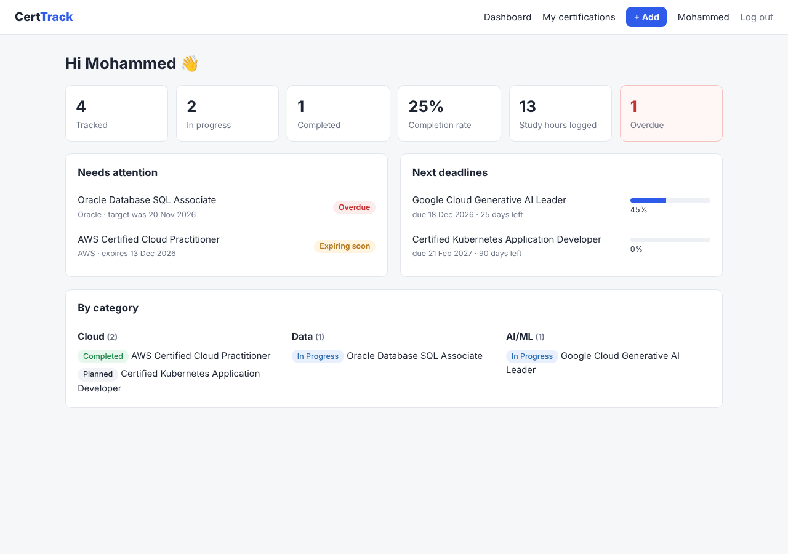
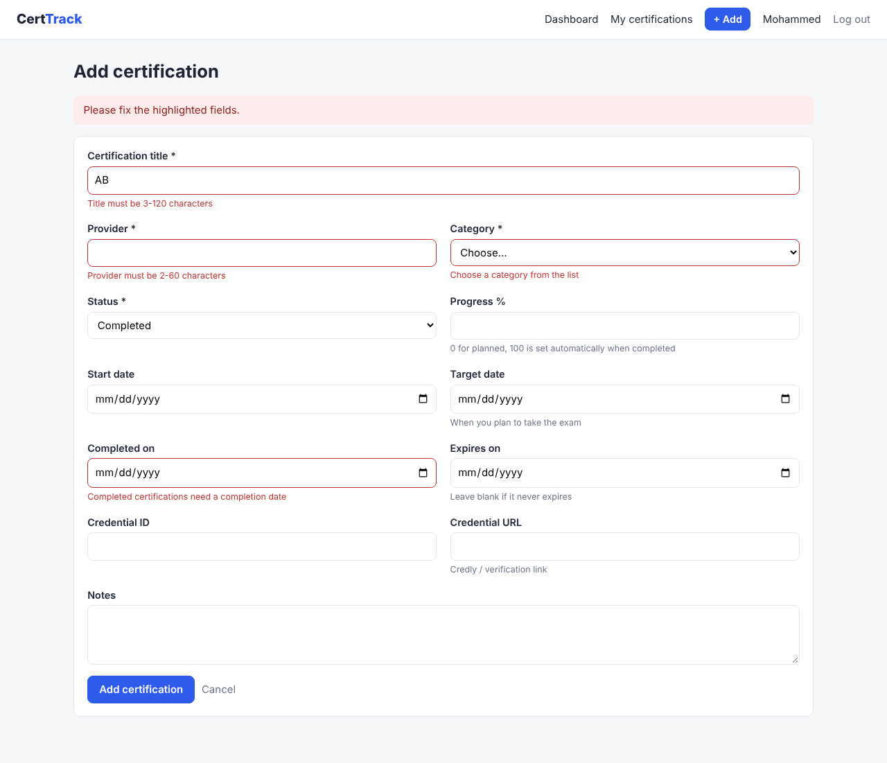
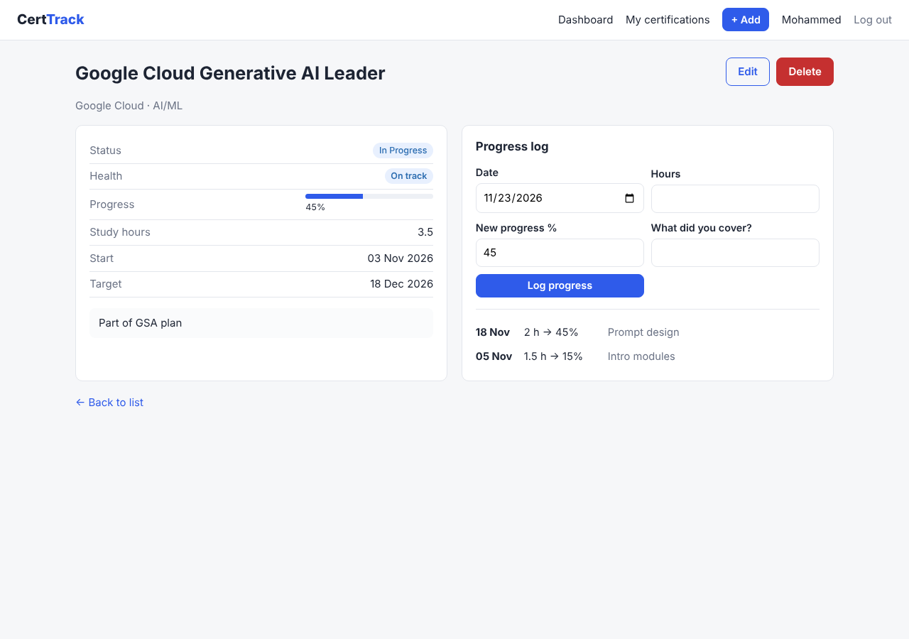
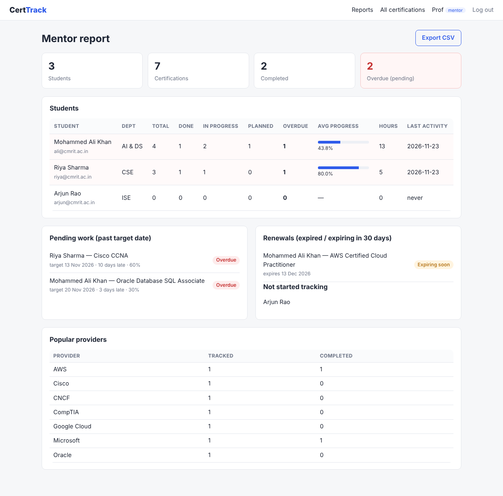

# CertTrack — Certification Progress Tracker

| | |
|---|---|
| **Student** | Mohammed Ali Khan |
| **USN** | 1CR24AD067 |
| **Project level** | Basic |
| **Stack** | Python 3.10+ · Flask · SQLite · HTML/CSS (Jinja templates) · pytest |

A web app where students track professional certifications (AWS, Google Cloud, Azure, Cisco…) from *planned* → *in progress* → *completed*, log study sessions, and see what is overdue or about to expire. Mentors get a read-only report showing which students have pending work.

## The problem in one line
Students track certifications in their heads, WhatsApp notes and scattered spreadsheets, so target dates slip unnoticed, renewal dates are missed, and mentors have no single view of who needs a nudge.
(Full problem statement and Design Thinking: [`docs/01_problem_and_design_thinking.md`](docs/01_problem_and_design_thinking.md))

## Features (mapped to the brief)

| Requirement | Where it is |
|---|---|
| User / profile management | Register, login/logout, edit name/department, change password (`auth.py`, `/profile`). Passwords hashed with Werkzeug (PBKDF2/scrypt). Mentors are created by an admin via CLI, not self-registration. |
| Core records + CRUD | Certifications: create / view / edit / delete (`/certifications`). Progress logs: create + list. |
| Search / filter | Keyword search (title, provider, notes, credential ID) + filter by status, category, provider + 4 sort orders. |
| Validation | `validators.py`: field rules + business rules (e.g. target ≥ start, completed ⇒ completion date, expiry > completion, progress can't go backwards). DB `CHECK`/`UNIQUE`/`FOREIGN KEY` constraints as a second layer. |
| Reports / dashboard | Student dashboard (counts, completion rate, hours, overdue, expiring, next 5 deadlines, by-category). Mentor report (per-student summary, pending work, renewals, inactive students, provider popularity, CSV export). |
| Relational database | SQLite, 4 normalised tables — see [`docs/02_data_model.md`](docs/02_data_model.md). |
| Exception handling | Custom hierarchy in `exceptions.py`, mapped to HTTP 400/401/403/404/409 and friendly pages/JSON. Transactions roll back on failure. |
| Basic HTTP / API | JSON REST API under `/api` (GET/POST/PUT/DELETE, status codes). |
| Tests | 50 pytest tests: validators, services, web routes, API. Manual test cases in [`docs/03_test_cases.md`](docs/03_test_cases.md). |

## Quick start

```powershell
python -m venv .venv
.\.venv\Scripts\Activate.ps1        # macOS/Linux: source .venv/bin/activate
pip install -r requirements.txt
python run.py                      # first run creates an EMPTY database
```

Open http://127.0.0.1:5000, click **Create account**, and start adding your own certifications.

| Command | What it does |
|---|---|
| `python run.py` | Start the app with your existing data |
| `python run.py --fresh` | Wipe everything and start empty |
| `python run.py --demo` | Wipe and load sample data (for demo / viva) |
| `flask --app run create-mentor` | Create a mentor account (mentors can't self-register) |
| `python -m pytest -v` | Run all tests |

Demo accounts (only after `--demo`): student `ali@cmrit.ac.in` / `Student@123`, mentor `mentor@cmrit.ac.in` / `Mentor@123`.

Search and filters apply instantly as you type or change a dropdown (no Apply button needed).

## Project structure

```
cert-tracker/
├── app/
│   ├── __init__.py       # app factory, CSRF check, error pages
│   ├── schema.sql        # tables, constraints, indexes
│   ├── db.py             # connection per request + CLI commands
│   ├── models.py         # OOP domain classes: User, Certification, ProgressLog, Status enum
│   ├── validators.py     # input + business-rule validation
│   ├── exceptions.py     # custom exception hierarchy
│   ├── repositories.py   # ALL SQL lives here (parameterised queries)
│   ├── services.py       # business logic + access control
│   ├── auth.py           # register / login / logout, login_required, mentor_required
│   ├── views.py          # HTML pages
│   ├── api.py            # JSON REST API
│   ├── seed.py           # demo data
│   ├── templates/        # Jinja HTML
│   └── static/style.css
├── tests/                # pytest suite
├── docs/                 # design thinking, ER model, test cases, viva prep
├── run.py
└── requirements.txt
```

**Layered architecture:** `views/api → services → repositories → SQLite`. Each layer only talks to the one below it, so business rules are testable without a browser and SQL is in exactly one file.

## REST API

All endpoints use the session cookie from `/api/login`.

| Method | Endpoint | Success | Errors |
|---|---|---|---|
| POST | `/api/login` | 200 | 401 |
| GET | `/api/certifications?q=&status=&category=&provider=&sort=` | 200 | 401 |
| POST | `/api/certifications` | 201 | 400, 409 |
| GET | `/api/certifications/<id>` | 200 | 403, 404 |
| PUT | `/api/certifications/<id>` | 200 | 400, 403, 404 |
| DELETE | `/api/certifications/<id>` | 204 | 403, 404 |
| POST | `/api/certifications/<id>/logs` | 201 | 400, 403 |
| GET | `/api/stats` | 200 | 401 |

```bash
curl -c c.txt -H "Content-Type: application/json" \
     -d '{"email":"ali@cmrit.ac.in","password":"Student@123"}' http://127.0.0.1:5000/api/login
curl -b c.txt "http://127.0.0.1:5000/api/certifications?status=in_progress"
curl -b c.txt -H "Content-Type: application/json" -X POST \
     -d '{"title":"Terraform Associate","provider":"HashiCorp","category":"Cloud","status":"planned"}' \
     http://127.0.0.1:5000/api/certifications
```

Validation errors come back as `400 {"error": "...", "fields": {"title": "Title must be 3-120 characters"}}`.

## Security measures
- Passwords hashed (never stored in plain text); same error for unknown email and wrong password.
- Parameterised SQL everywhere; `ORDER BY` uses a whitelist.
- CSRF token on every HTML form; logout is POST-only.
- Session cleared on login (session fixation) and `next=` only allows local paths (open redirect).
- Students can only see/modify their own records; mentors are read-only.

## Known limitations / future work
- SQLite is single-file and fine for a class; for many concurrent users switch to PostgreSQL (only `db.py` and a few SQLite-specific SQL bits like `datetime('now')` would change).
- No email reminders for deadlines/renewals yet — a scheduled job reading the same "overdue/expiring" queries would add this.
- No file upload for certificate PDFs (stores a verification URL instead).
- API uses session cookies; a production API would use tokens.

## Screenshots
| Dashboard | Validation errors |
|---|---|
|  |  |
| **Certification detail + progress log** | **Mentor report** |
|  |  |
