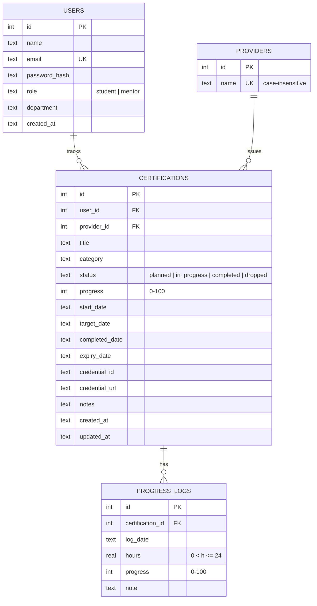

# Data Model

## ER diagram

(GitHub renders this diagram automatically. For your report, paste it into https://mermaid.live and export a PNG.)

## Relationships

| Relationship | Cardinality | On delete |
|---|---|---|
| User → Certifications | 1 : N | CASCADE (deleting a user removes their records) |
| Provider → Certifications | 1 : N | RESTRICT (default — a provider in use can't be deleted) |
| Certification → Progress logs | 1 : N | CASCADE |

## Constraints

| Constraint | Purpose |
|---|---|
| `users.email UNIQUE` | One account per email |
| `CHECK role IN (...)`, `CHECK status IN (...)` | Only allowed values |
| `CHECK progress BETWEEN 0 AND 100` | Valid percentage |
| `CHECK hours > 0 AND hours <= 24` | Realistic study log |
| `UNIQUE (user_id, provider_id, title)` | No duplicate tracking of the same cert |
| Foreign keys + `PRAGMA foreign_keys = ON` | Referential integrity (SQLite disables FKs unless turned on) |

## Normalisation
- **1NF:** every column holds one atomic value; no repeating groups (progress history is its own table rather than columns like `log1, log2…`).
- **2NF:** every table has a single-column surrogate key, so there are no partial dependencies.
- **3NF:** provider name is moved to `providers` so it depends only on `providers.id`, not on each certification. Derived values (overdue, expiring, total hours) are **computed**, not stored, to avoid stale data.

`certifications.progress` is the one deliberate denormalisation: it equals the latest log's progress, but stored for fast list/sort. It is updated in the same transaction as the log insert, so they can't disagree.

## Important queries
- **Search:** dynamic `WHERE` built from supplied filters with `?` placeholders (`repositories.py → CertificationRepository.search`).
- **Mentor summary:** `LEFT JOIN users–certifications` + `GROUP BY u.id` + `SUM(CASE WHEN …)` for per-status counts; `LEFT JOIN` so students with zero certifications still appear (`ReportRepository.student_summary`).
- **Indexes:** `user_id`, `status`, `target_date`, `progress_logs.certification_id` — the columns filtered or joined most often.
